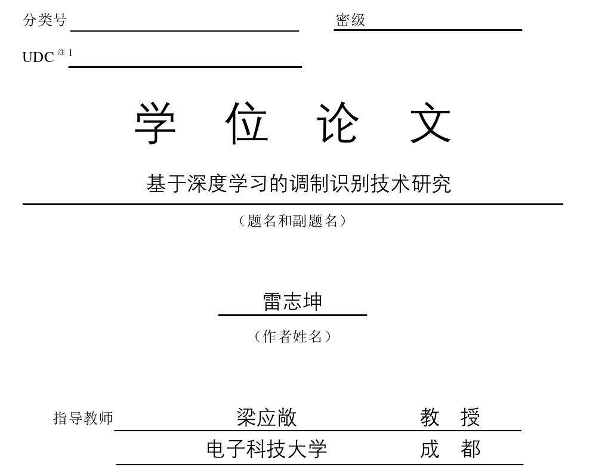
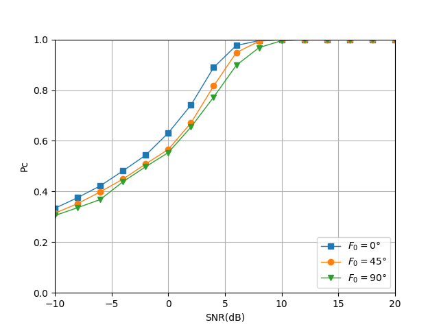
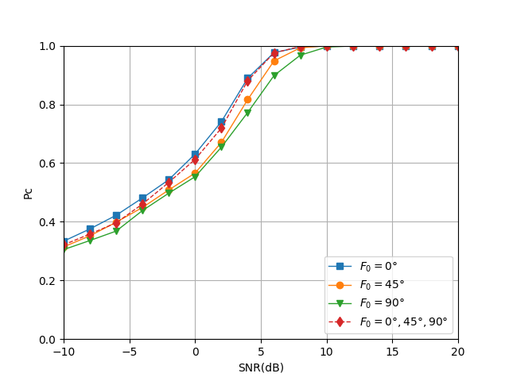
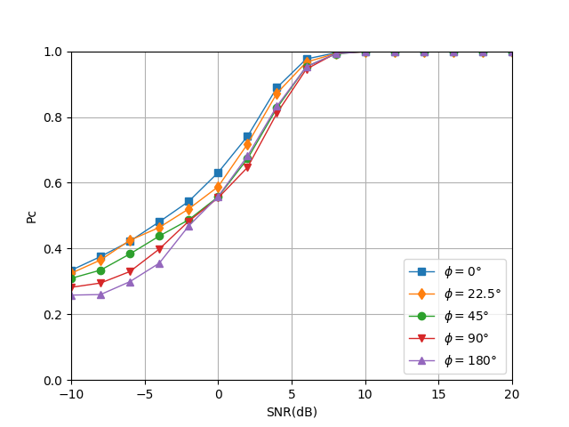
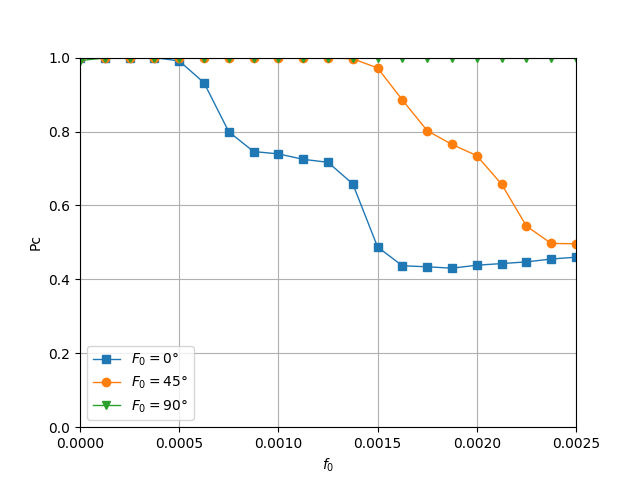
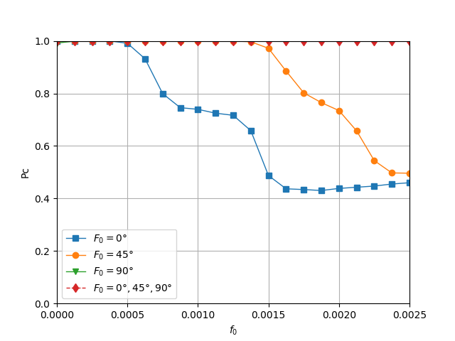
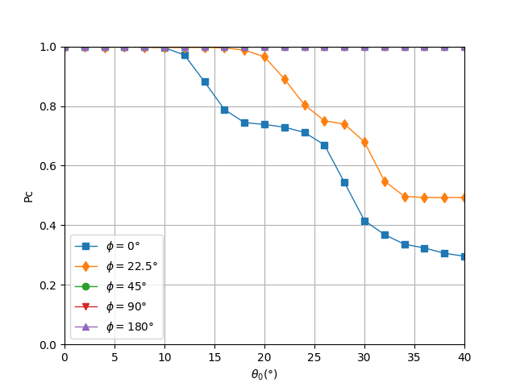

# [Modulation Identification] Research on Modulation Identification Technology Based on Deep Learning [Attached MATLAB Code]

Containing papers and code! Modulation recognition technology holds significant application value in both commercial and military fields. Modulation recognition can be categorized into two types: likelihood-based modulation recognition and signal feature-based modulation recognition. Due to the high computational complexity of likelihood-based modulation recognition, signal feature-based modulation recognition is generally more widely applied. Traditional signal feature-based modulation recognition involves designing and extracting signal features, followed by designing classification rules to classify these features based on modulation schemes. However, manually designed signal features and classification rules often have limited accuracy in complex channel environments. Therefore, deep learning-based modulation recognition techniques have been proposed to automatically learn classification rules from feature data to improve classification accuracy. In recent years, with the development of deep learning, deep learning algorithms have been widely applied in areas such as computer vision and natural language processing, achieving outstanding performance. In the field of modulation recognition, leveraging the latest deep learning algorithms allows for the automatic learning of both signal features and classification rules, further enhancing modulation recognition performance.
Firstly, this paper studies the modulation recognition technique using a fully connected neural network (FCNN) classifier. Theoretical analysis and simulation results indicate that FCNN classifiers offer better classification accuracy compared to manually designed classification rules.
Secondly, this paper investigates the modulation recognition technique based on convolutional neural networks (CNN). Theoretical analysis and simulation results show that well-designed and trained CNNs can simultaneously complete feature extraction and classification identification functions. Features extracted by CNNs are superior to traditional signal features in terms of modulation recognition performance. Building on this, this paper further examines the impact of training sets on CNNs. Theoretical analyses and simulation results indicate that diverse training sets can enhance the robustness of CNNs in modulation recognition.
Finally, this paper investigates the issue of modulation recognition performance degradation due to changes in channel environments in the context of CNN-based modulation recognition technology. Drawing on the theory of transfer learning (TL), this paper proposes three types of CNN-based transfer learning methods. Theoretical analysis and simulation results indicate that the first type of transfer learning method consistently achieves optimal modulation recognition performance in new channel environments. The second type of transfer learning method, when the training data is abundant in new channel environments, also possesses optimal modulation recognition performance while converging faster. The third type of transfer learning method, when the training data is moderate in new channel environments, achieves suboptimal modulation recognition performance but converges faster.
Keywords: Modulation recognition, Deep learning, Fully Connected Neural Networks, Convolutional Neural Networks, Transfer Learning
\n        \n  
\n        \n  
\n        \n  
\n        \n  
\n        \n  
\n        \n  

## Images

<!-- PAYMENT_BLOCK -->

## Get this dataset

- Payment link (Stripe): [Buy now](https://buy.stripe.com/3cs8yP7sY87d0vu9AB)
- Payment QR code: 

<!-- /PAYMENT_BLOCK -->
